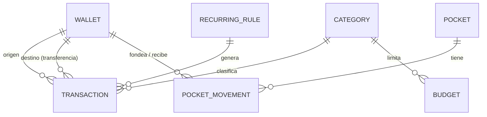
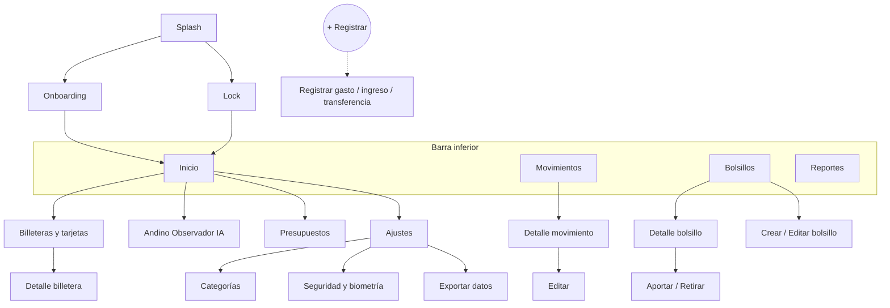
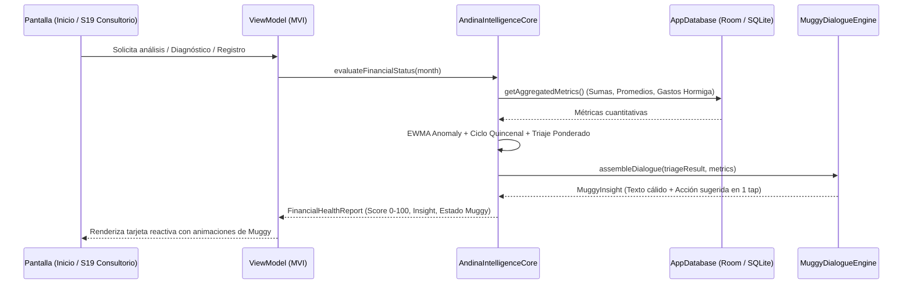
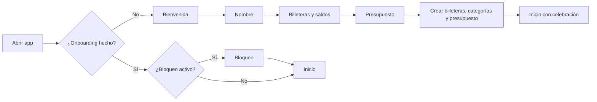
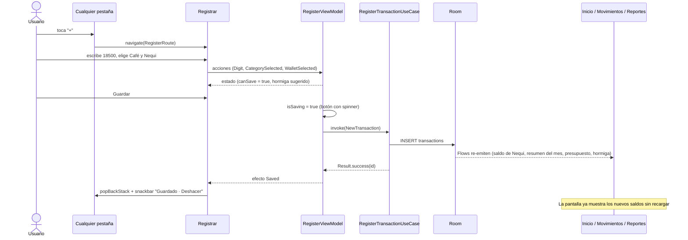
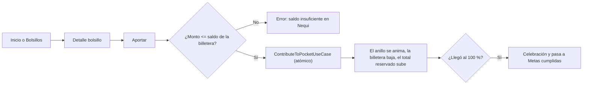

# 🐻 Andina — Arquitectura objetivo (Android nativo)

> Documento único de referencia. Describe **cómo debería estar construida la app completa**, por qué fallan hoy los botones, los ingresos, la interacción y la fluidez, y en qué orden corregirlo.

> [!NOTE]
> **Decisión de plataforma:** Andina es **solo Android**. Se confirma el stack nativo **Kotlin + Jetpack Compose**. No se usan Flutter, React Native ni Kotlin Multiplatform. Si en el futuro se necesitara iOS, la ruta de migración natural sería Kotlin Multiplatform reutilizando `domain` y `data`.

> [!TIP]
> **Documentos complementarios del proyecto:**
> * Plan de ejecución en 12 fases y Quality Gates: [**PLAN_DE_FASES.md**](./PLAN_DE_FASES.md)
> * Tokens, colores, tipografía y diseño: [**DISENO_VISUAL.md**](./DISENO_VISUAL.md)
> * Personalidad, poses y gamificación: [**MUGGY.md**](./MUGGY.md)
> * Animaciones y microinteracciones en Compose: [**MUGGY_INTERACCION.md**](./MUGGY_INTERACCION.md)
> * Motor técnico de cinemática e ingeniería de Muggy: [**MUGGY_MOTOR_TECNICO.md**](./MUGGY_MOTOR_TECNICO.md)
> * Sistemas de ayuda interactiva y simuladores: [**AYUDAS_INTERACTIVAS.md**](./AYUDAS_INTERACTIVAS.md)
> * Prevención de fallos y lecciones aprendidas: [**LECCIONES_Y_BLINDAJE.md**](./LECCIONES_Y_BLINDAJE.md)
> * Índice maestro: [**README.md**](./README.md)

---

## 0. Diagnóstico: por qué falla la versión actual

Antes de agregar pantallas hay que corregir estos problemas de raíz. Casi todos los síntomas vienen de aquí.

| # | Síntoma | Causa real en el código actual | Solución (sección) |
|---|---------|-------------------------------|--------------------|
| 1 | **Registro un ingreso y el saldo total no cambia** | El saldo total se calcula como la suma de `wallets.balanceCOP`, pero `addTransaction()` solo inserta la transacción. **Nunca actualiza el saldo de la billetera.** | §4.3 Ledger + `@Transaction` |
| 2 | **El botón “+” no hace nada fuera de Inicio** | El `QuickAddTransactionSheet` vive dentro de `HomeScreen`. En Bolsillos/Tarjetas/Movimientos se cambia el estado pero el sheet no está compuesto. | §6.3 Registro global en el App Shell |
| 3 | **Los botones de la barra inferior no compilan / se ven mal** | En `AndinaBottomBar` la `Column` usa `horizontalAlignment = Alignment.CenterVertically` (tipo incorrecto, debe ser `CenterHorizontally`). Además los ítems no tienen área táctil mínima de 48dp. | §7.1 |
| 4 | **Escribo el monto y a veces no guarda** | El campo acepta texto libre (`"50.000"` → `toDoubleOrNull()` = `null` → no guarda) sin mostrar error. No hay teclado numérico, ni máscara COP, ni mensaje de validación. | §7.2 Entrada de dinero |
| 5 | **Toco “Guardar” y no hay respuesta** | No hay estado de carga, ni snackbar de confirmación, ni manejo de errores. Doble toque = doble registro. | §7.3 |
| 6 | **Categoría siempre “General”** | El formulario envía `"General"` fijo. No existe tabla de categorías. | §4.2 |
| 7 | **Aporte a bolsillos no funciona** | `updatePocketAmount()` está vacío. | §5 Casos de uso |
| 8 | **Navegación sin “atrás”, pantallas placeholder** | Navegación con un `when` + `mutableStateOf`; no hay back stack, ni deep links, ni rutas para detalle. Tarjetas y Movimientos son textos. | §6 |
| 9 | **Lag al hacer scroll** | Transacciones renderizadas con `forEach` dentro de un solo `item {}` del `LazyColumn` (se componen todas de golpe); listas no estables; `collectAsState` en vez de `collectAsStateWithLifecycle`. | §8 |
| 10 | **Llamadas a servidores externos innecesarias** | Anteriormente se intentaba llamar a Gemini en la nube en cada emisión, provocando lentitud y consumo de datos. | §10 Motor On-Device 100% Offline |
| 11 | **Dinero con `Double`** | Errores de redondeo acumulados. | §4.1 |
| 12 | **Seguridad débil** | Contraseña de BD escrita en el código; hoy la BD ni siquiera está cifrada (el `AppDatabase` actual no usa SQLCipher). El catálogo apunta a la librería **antigua** `android-database-sqlcipher` y las reglas ProGuard a la **nueva** (`net.zetetic.database.sqlcipher`): están desalineadas. | §2.1 · §9 |
| 13 | **Gradle inestable** | Versiones de AGP/Gradle editadas a mano. | §2 |
| 14 | **Eliminación total de SDKs cloud de IA** | Se erradica cualquier dependencia de IA remota (`generativeai` o APIs de nube), sustituyéndola por el Motor de Inteligencia Local On-Device (NLP + Series de Tiempo + Triaje Financiero + NLG Paramuno). | §10 |
| 15 | **DI manual frágil** | `AppContainer` + `ViewModelProvider.Factory` a mano por cada ViewModel. | §2.1 |

> [!IMPORTANT]
> **Regla de oro:** el saldo **nunca** se edita “a mano” desde la UI. Todo cambio de dinero es un **movimiento** registrado en un *ledger*, y los saldos se **derivan** o se actualizan **dentro de la misma transacción de BD**.

---

## 1. Principios de arquitectura

1. **Clean Architecture por capas** → `ui` → `domain` → `data`. La UI nunca habla con Room directamente.
2. **Flujo de datos unidireccional (UDF / MVI)**: la pantalla emite `Acciones`, el ViewModel produce un único `UiState` inmutable y `Efectos` de una sola vez (snackbar, navegar, vibrar).
3. **Offline-first**: Room es la única fuente de verdad. La IA y cualquier sincronización son opcionales.
4. **Dinero exacto**: `Long` en pesos (COP no usa centavos en la práctica).
5. **Una sola forma de registrar movimientos** (un caso de uso) usada desde cualquier pantalla.
6. **Inyección de dependencias con Hilt** (en lugar del contenedor manual).
7. **Accesible y táctil**: objetivos ≥ 48dp, contraste AA, `contentDescription`, TalkBack.

---

## 2. Stack y build

| Área | Elección | Nota |
|------|----------|------|
| Lenguaje | Kotlin 2.x + Compose Compiler plugin | |
| UI | Jetpack Compose + Material 3 | Material You opcional, se mantiene la paleta Andean Mist & Moss |
| Navegación | Navigation Compose **type-safe** (`@Serializable` routes) | requiere `kotlinx-serialization` |
| DI | Hilt + `hilt-navigation-compose` | |
| BD | Room (KSP) + SQLCipher (`net.zetetic:sqlcipher-android`) | passphrase desde Android Keystore |
| Preferencias | DataStore (Proto o Preferences) | nombre, nivel, ajustes, onboarding |
| Async | Coroutines + Flow | |
| Listas largas | Paging 3 (`room-paging`) | historial de movimientos |
| Gráficas | Vico (Compose) | estadísticas |
| Background | WorkManager | recurrentes, recordatorios diarios |
| Biometría | `androidx.biometric` | bloqueo de la app |
| Inteligencia | **Andina Intelligence Core (On-Device)** | 100% offline, local en Kotlin/Room, sin nubes ni API keys (§10) |
| Rendimiento | Baseline Profiles + R8 | |
| Tests | JUnit, Turbine, Room in-memory, Compose UI Test, Robolectric | |

> [!WARNING]
> **Versiones de Gradle/AGP**: no las edites a mano. Usa las que propone tu Android Studio mediante **Tools → AGP Upgrade Assistant**, y alinea `kotlin`, `ksp` y `compose` con esa versión de AGP. Mantén todo en `gradle/libs.versions.toml`.

### 2.1 Auditoría del stack actual

| Tecnología actual | Veredicto | Acción |
|-------------------|-----------|--------|
| Kotlin | ✅ Mantener | Lenguaje oficial de Android |
| Jetpack Compose + Material 3 | ✅ Mantener | Estándar de UI; mejor fluidez y animaciones |
| Room + KSP | ✅ Mantener | Agregar `room-paging` y `exportSchema = true` |
| Coroutines + Flow | ✅ Mantener | Usar `stateIn` + `collectAsStateWithLifecycle` |
| Navigation Compose | ⚠️ Instalada pero **sin usar** | Reemplazar el `when` por un `NavHost` type-safe (§6) |
| `Double` para dinero | ❌ Reemplazar | `Long` / `Money` (§4.1) |
| `net.zetetic:android-database-sqlcipher` | ❌ Reemplazar (legacy, sin mantenimiento) | `net.zetetic:sqlcipher-android` + `SupportOpenHelperFactory` |
| `com.google.ai.client.generativeai` | ❌ Eliminar por completo | **Andina Intelligence Core** (§10) — 100% On-Device, cero nubes, cero API keys |
| `AppContainer` manual | ❌ Reemplazar | **Hilt** (`@HiltAndroidApp`, `@HiltViewModel`, `hiltViewModel()`) |
| `collectAsState` | ❌ Reemplazar | `lifecycle-runtime-compose` → `collectAsStateWithLifecycle` |
| — | ➕ Agregar | DataStore, Paging 3, WorkManager, Biometric, Vico, kotlinx-serialization, kotlinx-collections-immutable, Splash Screen, Baseline Profiles |

### 2.2 Especificación Blindada de `libs.versions.toml`

> Versiones estables, alineadas y probadas para evitar bucles de sincronización en Android Studio y saturación de memoria.

```toml
[versions]
agp = "8.7.2"
kotlin = "2.0.21"
ksp = "2.0.21-1.0.25"
composeBom = "2024.10.01"
room = "2.6.1"
sqlcipher = "4.5.4"
hilt = "2.52"
hiltNavigationCompose = "1.2.0"
navigationCompose = "2.8.3"
lifecycle = "2.8.6"
datastore = "1.1.1"
paging = "3.3.2"
work = "2.9.1"
biometric = "1.2.0-alpha05"
splashscreen = "1.0.1"
serialization = "1.7.3"
immutable = "0.3.8"
vico = "2.0.0-alpha.28"

[libraries]
# BD cifrada y paginación
sqlcipher-android = { group = "net.zetetic", name = "sqlcipher-android", version.ref = "sqlcipher" }
androidx-room-runtime = { group = "androidx.room", name = "room-runtime", version.ref = "room" }
androidx-room-ktx = { group = "androidx.room", name = "room-ktx", version.ref = "room" }
androidx-room-compiler = { group = "androidx.room", name = "room-compiler", version.ref = "room" }
androidx-room-paging = { group = "androidx.room", name = "room-paging", version.ref = "room" }

# Inyección de dependencias (Hilt)
hilt-android = { group = "com.google.dagger", name = "hilt-android", version.ref = "hilt" }
hilt-compiler = { group = "com.google.dagger", name = "hilt-compiler", version.ref = "hilt" }
androidx-hilt-navigation-compose = { group = "androidx.hilt", name = "hilt-navigation-compose", version.ref = "hiltNavigationCompose" }

# Navegación y ciclo de vida Compose
androidx-navigation-compose = { group = "androidx.navigation", name = "navigation-compose", version.ref = "navigationCompose" }
androidx-lifecycle-runtime-compose = { group = "androidx.lifecycle", name = "lifecycle-runtime-compose", version.ref = "lifecycle" }
androidx-lifecycle-viewmodel-compose = { group = "androidx.lifecycle", name = "viewmodel-compose", version.ref = "lifecycle" }

# Almacenamiento local, Workers y Biometría
androidx-datastore-preferences = { group = "androidx.datastore", name = "datastore-preferences", version.ref = "datastore" }
androidx-paging-compose = { group = "androidx.paging", name = "paging-compose", version.ref = "paging" }
androidx-work-runtime-ktx = { group = "androidx.work", name = "work-runtime-ktx", version.ref = "work" }
androidx-biometric = { group = "androidx.biometric", name = "biometric", version.ref = "biometric" }
androidx-core-splashscreen = { group = "androidx.core", name = "core-splashscreen", version.ref = "splashscreen" }

# Estructuras de datos inmutables y serialización
kotlinx-serialization-json = { group = "org.jetbrains.kotlinx", name = "kotlinx-serialization-json", version.ref = "serialization" }
kotlinx-collections-immutable = { group = "org.jetbrains.kotlinx", name = "kotlinx-collections-immutable", version.ref = "immutable" }

# Gráficas
vico-compose-m3 = { group = "com.patrykandpatrick.vico", name = "compose-m3", version.ref = "vico" }

[plugins]
android-application = { id = "com.android.application", version.ref = "agp" }
kotlin-android = { id = "org.jetbrains.kotlin.android", version.ref = "kotlin" }
kotlin-compose = { id = "org.jetbrains.kotlin.plugin.compose", version.ref = "kotlin" }
kotlin-serialization = { id = "org.jetbrains.kotlin.plugin.serialization", version.ref = "kotlin" }
ksp = { id = "com.google.devtools.ksp", version.ref = "ksp" }
hilt = { id = "com.google.dagger.hilt.android", version.ref = "hilt" }
```

**Reglas R8 a actualizar** en `proguard-rules.pro` (alineadas con `sqlcipher-android`):

```proguard
-keep class net.zetetic.database.** { *; }
-keep class net.zetetic.database.sqlcipher.** { *; }
-dontwarn net.zetetic.database.**
```

---

## 3. Estructura de paquetes

Un solo módulo `:app` es suficiente para empezar, organizado por **feature**. Cuando crezca, cada carpeta `feature/*` puede volverse un módulo Gradle.

```
com.andina.finanzas/
├── AndinaApp.kt                      @HiltAndroidApp
├── MainActivity.kt                   Edge-to-edge, bloqueo biométrico, setContent { AndinaApp() }
│
├── core/
│   ├── designsystem/                 Theme, Color, Type, Shape, Dimens
│   │   └── component/                AndinaButton, MoneyText, MoneyInput, FrostedCard,
│   │                                 AndinaTopBar, EmptyState, LoadingState, ErrorState,
│   │                                 CategoryChip, WalletChip, ProgressBar, Muggy (mascota)
│   ├── common/                       Result<T>, DispatcherProvider, Clock, extensiones
│   ├── money/                        Money (value class), CopFormatter, CopInputTransformation
│   └── security/                     KeystorePassphraseProvider, BiometricGate
│
├── data/
│   ├── local/
│   │   ├── AndinaDatabase.kt
│   │   ├── entity/                   WalletEntity, CategoryEntity, TransactionEntity,
│   │   │                             PocketEntity, PocketMovementEntity, BudgetEntity,
│   │   │                             RecurringRuleEntity
│   │   ├── dao/                      WalletDao, CategoryDao, TransactionDao, PocketDao,
│   │   │                             BudgetDao, RecurringDao, LedgerDao (operaciones atómicas)
│   │   ├── view/                     WalletBalanceView, MonthlySummaryView (DatabaseView)
│   │   ├── converter/
│   │   └── seed/                     DatabaseSeeder (categorías y billeteras por defecto)
│   ├── preferences/                  UserPreferencesDataSource (DataStore)
│   ├── intelligence/                 AndinaIntelligenceCore, MerchantFuzzyClassifier, ColombianBankSmsParser
│   ├── mapper/                       Entity ⇄ Domain
│   └── repository/                   *RepositoryImpl
│
├── domain/
│   ├── model/                        Wallet, Category, Transaction, Pocket, Budget,
│   │                                 MonthlySummary, Insight, Money, TxType
│   ├── repository/                   Interfaces
│   └── usecase/                      (ver §5)
│
├── feature/
│   ├── onboarding/
│   ├── lock/
│   ├── home/
│   ├── transactions/                 lista, filtros, detalle, editar
│   ├── register/                     registrar gasto / ingreso / transferencia (global)
│   ├── pockets/                      lista, detalle, aportar, retirar, crear/editar
│   ├── budgets/
│   ├── wallets/                      billeteras y tarjetas
│   ├── stats/                        reportes y gráficas
│   ├── advisor/                      Andino Observador (chat IA)
│   └── settings/                     perfil, categorías, seguridad, exportar, acerca de
│       Cada feature: XxxRoute.kt · XxxScreen.kt · XxxViewModel.kt · XxxContract.kt
│
└── navigation/
    ├── AndinaDestinations.kt         rutas @Serializable
    ├── AndinaNavHost.kt
    └── AndinaAppShell.kt             Scaffold + BottomBar + Registro global + Snackbar host
```

---

## 4. Capa de datos

### 4.1 Dinero

```kotlin
@JvmInline
value class Money(val pesos: Long) {
    operator fun plus(o: Money) = Money(pesos + o.pesos)
    operator fun minus(o: Money) = Money(pesos - o.pesos)
    val isPositive get() = pesos > 0
    companion object { val ZERO = Money(0) }
}
```
En Room se guarda como `Long` (`amount INTEGER NOT NULL`). Nunca `Double`.

### 4.2 Modelo de datos (esquema)



| Tabla | Campos clave |
|-------|--------------|
| `wallets` | `id`, `name`, `type` (NEQUI, DAVIPLATA, BANCOLOMBIA, EFECTIVO, TARJETA_CREDITO, OTRA), `initialBalance: Long`, `colorHex`, `archived`, `sortOrder` |
| `categories` | `id`, `name`, `icon`, `colorHex`, `kind` (GASTO/INGRESO), `isAntCandidate` (Café, Snacks, Domicilios…), `isDefault` |
| `transactions` | `id`, `type` (GASTO, INGRESO, TRANSFERENCIA), `amount: Long`, `walletId`, `toWalletId?`, `categoryId?`, `note`, `occurredAt`, `createdAt`, `isAntExpense`, `receiptUri?`, `recurringRuleId?` — índices en `occurredAt`, `walletId`, `categoryId` |
| `pockets` | `id`, `name`, `goal: Long`, `icon`, `colorHex`, `deadline?`, `archived` |
| `pocket_movements` | `id`, `pocketId`, `walletId`, `amount: Long` (+ aporte / − retiro), `occurredAt` |
| `budgets` | `id`, `categoryId?` (null = global), `monthlyLimit: Long`, `month` (YYYY-MM) |
| `recurring_rules` | `id`, plantilla de transacción, `frequency`, `nextRunAt` |

### 4.3 Saldos correctos (soluciona “los ingresos no suman”)

**Opción recomendada — saldo derivado del ledger** (imposible que se desincronice):

```kotlin
@DatabaseView("""
SELECT w.id AS walletId,
  w.initialBalance
  + COALESCE((SELECT SUM(amount) FROM transactions WHERE walletId = w.id AND type = 'INGRESO'), 0)
  - COALESCE((SELECT SUM(amount) FROM transactions WHERE walletId = w.id AND type = 'GASTO'), 0)
  - COALESCE((SELECT SUM(amount) FROM transactions WHERE walletId = w.id AND type = 'TRANSFERENCIA'), 0)
  + COALESCE((SELECT SUM(amount) FROM transactions WHERE toWalletId = w.id AND type = 'TRANSFERENCIA'), 0)
  - COALESCE((SELECT SUM(amount) FROM pocket_movements WHERE walletId = w.id), 0)
  AS balance
FROM wallets w WHERE w.archived = 0
""", viewName = "wallet_balances")
data class WalletBalanceView(val walletId: Long, val balance: Long)
```

- `Patrimonio total` = Σ saldos de billeteras + Σ saldos de bolsillos.
- Como Room observa las tablas de la vista, **cualquier inserción re-emite el Flow** y la pantalla de Inicio se actualiza sola.

**Operaciones de varias tablas** (aporte a bolsillo, transferencia, editar/borrar) siempre atómicas:

```kotlin
@Dao
interface LedgerDao {
    @Insert suspend fun insertTx(tx: TransactionEntity): Long
    @Insert suspend fun insertPocketMovement(m: PocketMovementEntity): Long

    @Transaction
    suspend fun contributeToPocket(pocketId: Long, walletId: Long, amount: Long, at: Long) {
        insertPocketMovement(PocketMovementEntity(pocketId = pocketId, walletId = walletId, amount = amount, occurredAt = at))
    }
}
```

### 4.4 DAOs: consultas clave

```kotlin
@Query("SELECT * FROM wallet_balances") fun observeBalances(): Flow<List<WalletBalanceView>>

@Query("""
SELECT
  COALESCE(SUM(CASE WHEN type='INGRESO' THEN amount END),0) AS income,
  COALESCE(SUM(CASE WHEN type='GASTO'   THEN amount END),0) AS expense,
  COALESCE(SUM(CASE WHEN type='GASTO' AND isAntExpense=1 THEN amount END),0) AS ant
FROM transactions WHERE occurredAt BETWEEN :from AND :to
""")
fun observeMonthSummary(from: Long, to: Long): Flow<MonthSummaryRow>

@Query("SELECT * FROM transactions WHERE (:q = '' OR note LIKE '%'||:q||'%') AND (:type IS NULL OR type=:type) ORDER BY occurredAt DESC")
fun pagingSource(q: String, type: String?): PagingSource<Int, TransactionWithRefs>

@Query("SELECT categoryId, SUM(amount) total FROM transactions WHERE type='GASTO' AND occurredAt BETWEEN :from AND :to GROUP BY categoryId ORDER BY total DESC")
fun observeSpendByCategory(from: Long, to: Long): Flow<List<CategoryTotalRow>>
```

### 4.5 Seed y migraciones
- `DatabaseSeeder` inserta categorías y billeteras por defecto en `onCreate`, **usando el `SupportSQLiteDatabase` recibido** (no `getInstance()` dentro del callback).
- `exportSchema = true` + `room { schemaDirectory("$projectDir/schemas") }` y **migraciones reales** (`AutoMigration`). Quitar `fallbackToDestructiveMigration()` antes de publicar: borra los datos del usuario.

---

## 5. Capa de dominio (casos de uso)

Toda regla de negocio vive aquí, no en la UI ni en los DAO.

| Caso de uso | Responsabilidad |
|-------------|-----------------|
| `RegisterTransactionUseCase` | Valida (monto > 0, billetera existe, categoría acorde al tipo, transferencia con destino distinto), calcula `isAntExpense`, inserta, devuelve `Result` |
| `UpdateTransactionUseCase` / `DeleteTransactionUseCase` | Editar y borrar (con **deshacer**) |
| `TransferBetweenWalletsUseCase` | Ej. Bancolombia → Nequi |
| `ContributeToPocketUseCase` / `WithdrawFromPocketUseCase` | Valida saldo suficiente en la billetera / bolsillo |
| `ObserveHomeDashboardUseCase` | Combina saldos, resumen del mes, bolsillos, últimos 5 movimientos, presupuesto |
| `ObserveBudgetsProgressUseCase` | % consumido por categoría, alertas al 80 % y 100 % |
| `DetectAntExpensesUseCase` | Reglas: categoría marcada como hormiga **o** monto ≤ umbral configurable (por defecto $25.000) y frecuencia ≥ 3/semana. **El usuario siempre puede desmarcarlo** (hoy el repositorio lo sobrescribe) |
| `GetFinancialLevelUseCase` | Gamificación: Semilla → Bosque → Páramo → Nevado según tasa de ahorro |
| `GenerateInsightUseCase` | Insight local inmediato + IA opcional (cacheado) |
| `ExportDataUseCase` | CSV / PDF |

```kotlin
class RegisterTransactionUseCase @Inject constructor(
    private val txRepo: TransactionRepository,
    private val antDetector: DetectAntExpensesUseCase,
    private val clock: Clock,
) {
    suspend operator fun invoke(input: NewTransaction): Result<Long> {
        if (!input.amount.isPositive) return Result.failure(ValidationError.AmountRequired)
        if (input.type == TxType.TRANSFERENCIA && input.toWalletId == input.walletId)
            return Result.failure(ValidationError.SameWallet)
        val isAnt = input.isAntOverride ?: antDetector.isAnt(input)
        return runCatching { txRepo.insert(input.copy(isAntExpense = isAnt, createdAt = clock.now())) }
    }
}
```

---

## 6. Navegación y pantallas

> [!TIP]
> Esta sección da la visión general. La **ficha detallada de cada pantalla, la tabla completa de rutas, los flujos de usuario paso a paso y qué se actualiza con cada acción** están en la **§16 Especificación de pantallas y flujos**.

### 6.1 Mapa de pantallas



| Pantalla | Contenido principal |
|----------|---------------------|
| **Onboarding** (3 pasos) | Nombre, billeteras que usa y saldo inicial de cada una, presupuesto mensual. Muggy guía el proceso |
| **Bloqueo** | Huella/rostro o PIN al abrir y al volver de segundo plano > 1 min |
| **Inicio** | Saludo + nivel, patrimonio (ocultable), Entró/Salió/Te queda, barra de presupuesto, insight de Andino, billeteras, bolsillos, últimos 5 movimientos → “Ver todos” |
| **Movimientos** | Lista paginada agrupada por día (encabezados fijos), búsqueda, filtros (tipo, billetera, categoría, rango, solo hormiga), swipe para borrar con deshacer |
| **Detalle movimiento** | Datos, recibo adjunto, editar, duplicar, borrar |
| **Registrar** | Selector Gasto/Ingreso/Transferencia, teclado numérico propio con máscara COP, categoría (grid de chips), billetera, fecha, nota, adjuntar recibo, interruptor hormiga |
| **Bolsillos** | Total reservado, lista con progreso, crear |
| **Detalle bolsillo** | Progreso, fecha meta, “te faltan $X, ahorra $Y/semana”, historial de aportes, aportar/retirar |
| **Presupuestos** | Global y por categoría, % consumido, alertas |
| **Billeteras** | Saldo por billetera, transferir, ajustar saldo (genera movimiento de ajuste), tarjetas de crédito con cupo y fecha de corte |
| **Reportes** | Gasto por categoría (dona), tendencia 6 meses (barras), gastos hormiga del mes y su “costo anual”, tasa de ahorro |
| **Andino Observador** | Chat con contexto financiero resumido, sugerencias rápidas (“¿En qué gasto más?”) |
| **Ajustes** | Perfil, categorías, umbral hormiga, moneda, seguridad, exportar, borrar datos, acerca de |

### 6.2 Rutas type-safe

```kotlin
@Serializable object HomeRoute
@Serializable object TransactionsRoute
@Serializable data class TransactionDetailRoute(val id: Long)
@Serializable object PocketsRoute
@Serializable data class PocketDetailRoute(val id: Long)
@Serializable object StatsRoute
@Serializable data class RegisterRoute(val type: TxType = TxType.GASTO, val editId: Long? = null)
```

Barra inferior con estado preservado:

```kotlin
navController.navigate(route) {
    popUpTo(navController.graph.findStartDestination().id) { saveState = true }
    launchSingleTop = true
    restoreState = true
}
```

### 6.3 App Shell y registro global (soluciona el “+” muerto)

El botón **Registrar** pertenece al **shell**, no a Inicio. Abre `RegisterRoute` (pantalla completa o `ModalBottomSheet` como destino de diálogo) desde **cualquier pestaña**, con su propio `RegisterViewModel`.

```kotlin
@Composable
fun AndinaAppShell(appState: AndinaAppState) {
    val snackbar = remember { SnackbarHostState() }
    Scaffold(
        snackbarHost = { SnackbarHost(snackbar) },
        bottomBar = {
            if (appState.showBottomBar) AndinaBottomBar(
                current = appState.currentTab,
                onTab = appState::navigateToTab,
                onRegister = { appState.navController.navigate(RegisterRoute()) },
            )
        },
        contentWindowInsets = WindowInsets(0),
    ) { padding ->
        AndinaNavHost(appState.navController, snackbar, Modifier.padding(padding))
    }
}
```

La barra inferior se oculta en pantallas de detalle/formulario (`showBottomBar` según el destino actual).

---

## 7. Interacción, botones y formularios

### 7.1 Botones
- Componente único `AndinaButton(text, onClick, loading, enabled, variant)` — **todos** los botones lo usan.
- Mientras `loading = true`: muestra spinner, queda deshabilitado → **evita dobles registros**.
- Área táctil ≥ 48dp (`Modifier.minimumInteractiveComponentSize()`), ripple visible (no usar `indication = null` en elementos principales).
- Feedback háptico en acciones de dinero (`LocalHapticFeedback.current.performHapticFeedback(...)`).
- Ítems de la barra inferior: `NavigationBarItem` de Material 3 (accesible, con indicador animado) + FAB central.

### 7.2 Entrada de dinero
- `MoneyInput` con `KeyboardOptions(keyboardType = KeyboardType.Number)` o, mejor, **teclado numérico propio** en la pantalla Registrar (más rápido, sin saltos de layout).
- El estado guarda **solo dígitos** (`"50000"`); la máscara `$ 50.000` es visual (`VisualTransformation` / `OutputTransformation`).
- Botones rápidos: `+10 mil`, `+20 mil`, `+50 mil`.
- Validación en vivo con mensaje de error bajo el campo; “Guardar” deshabilitado hasta que el formulario sea válido.
- Recordar última billetera y categoría usadas (DataStore).

### 7.3 Contrato MVI de cada pantalla

```kotlin
data class RegisterUiState(
    val type: TxType = TxType.GASTO,
    val amountDigits: String = "",
    val walletId: Long? = null,
    val categoryId: Long? = null,
    val note: String = "",
    val occurredAt: Long,
    val isAnt: Boolean? = null,
    val wallets: ImmutableList<WalletUi> = persistentListOf(),
    val categories: ImmutableList<CategoryUi> = persistentListOf(),
    val amountError: String? = null,
    val isSaving: Boolean = false,
) { val canSave get() = amountDigits.isNotEmpty() && walletId != null && !isSaving }

sealed interface RegisterAction {
    data class TypeChanged(val type: TxType) : RegisterAction
    data class Digit(val d: Char) : RegisterAction
    data object Backspace : RegisterAction
    data class WalletSelected(val id: Long) : RegisterAction
    data class CategorySelected(val id: Long) : RegisterAction
    data object Save : RegisterAction
}

sealed interface RegisterEffect {
    data class Saved(val txId: Long) : RegisterEffect   // cerrar + snackbar "Guardado · Deshacer"
    data class Error(val message: String) : RegisterEffect
}
```

```kotlin
@HiltViewModel
class RegisterViewModel @Inject constructor(
    private val register: RegisterTransactionUseCase,
    /* ... */
) : ViewModel() {
    private val _state = MutableStateFlow(RegisterUiState(occurredAt = System.currentTimeMillis()))
    val state = _state.asStateFlow()
    private val _effects = Channel<RegisterEffect>(Channel.BUFFERED)
    val effects = _effects.receiveAsFlow()

    fun onAction(a: RegisterAction) { when (a) {
        RegisterAction.Save -> save()
        /* ... */
        else -> {}
    } }

    private fun save() {
        val s = _state.value
        if (!s.canSave) return                       // protección contra doble toque
        _state.update { it.copy(isSaving = true) }
        viewModelScope.launch {
            register(s.toNewTransaction())
                .onSuccess { _effects.send(RegisterEffect.Saved(it)) }
                .onFailure { _effects.send(RegisterEffect.Error(it.toUserMessage())) }
            _state.update { it.copy(isSaving = false) }
        }
    }
}
```

Patrón **Route / Screen**: `XxxRoute` obtiene el ViewModel (`hiltViewModel()`), recolecta estado y efectos; `XxxScreen(state, onAction)` es puro y previsualizable.

```kotlin
@Composable
fun RegisterRoute(onDone: () -> Unit, snackbar: SnackbarHostState, vm: RegisterViewModel = hiltViewModel()) {
    val state by vm.state.collectAsStateWithLifecycle()
    LaunchedEffect(Unit) {
        vm.effects.collect { e -> when (e) {
            is RegisterEffect.Saved -> { onDone(); snackbar.showSnackbar("Movimiento guardado", "Deshacer") }
            is RegisterEffect.Error -> snackbar.showSnackbar(e.message)
        } }
    }
    RegisterScreen(state, vm::onAction)
}
```

### 7.4 Estados de pantalla
Cada pantalla contempla: **Cargando** (skeleton/shimmer), **Vacío** (Muggy + llamada a la acción: “Registra tu primer gasto”), **Contenido**, **Error** (mensaje + reintentar).

---

## 8. Fluidez y rendimiento

| Regla | Cómo |
|-------|------|
| Listas perezosas reales | Cada transacción es un `item(key = { it.id })`, nunca `forEach` dentro de un item. `contentType` para encabezados vs filas |
| Historial grande | Paging 3 + `collectAsLazyPagingItems()` |
| Recolección segura | `collectAsStateWithLifecycle()` siempre |
| Estabilidad | Modelos UI `@Immutable` y `kotlinx.collections.immutable` (`ImmutableList`) para que Compose omita recomposiciones |
| Cálculos | Formateo de dinero y agrupación por día en el ViewModel (o `remember(key)`), no en cada recomposición |
| Lecturas que cambian rápido | `derivedStateOf` (ej. mostrar FAB según scroll), lambdas en modifiers (`Modifier.offset { }`, `graphicsLayer { }`) |
| Hilos | Room ya usa su propio executor; mapeos pesados con `flowOn(Dispatchers.Default)` |
| `stateIn` | `.stateIn(viewModelScope, SharingStarted.WhileSubscribed(5_000), initial)` en lugar de `collect` + `update` manual |
| Animaciones | `AnimatedContent` para el saldo, `animateFloatAsState` en barras de progreso, transiciones de navegación compartidas, `animateItem()` en listas |
| Arranque | Baseline Profile (módulo `:baselineprofile`) + Splash Screen API; R8 activado en release |
| Medición | Probar siempre en build **release** (debug es mucho más lento), Layout Inspector para contar recomposiciones, Macrobenchmark |
| Efecto vidrio | `Modifier.blur` es costoso; usar fondos translúcidos + borde (como ahora) y reservar blur real para Android 12+ |

---

## 9. Seguridad

1. **BD cifrada con SQLCipher** (`net.zetetic:sqlcipher-android` + `SupportOpenHelperFactory`).
2. **Passphrase aleatoria** de 32 bytes generada una sola vez, cifrada con una clave AES del **Android Keystore** y guardada en DataStore. Nunca en el código.
3. **Bloqueo biométrico** (`BiometricPrompt`, fallback a PIN) al abrir y tras inactividad.
4. `FLAG_SECURE` opcional para ocultar la app en recientes y bloquear capturas.
5. `android:allowBackup="false"` (o reglas de backup que excluyan la BD).
6. Reglas R8 correctas para SQLCipher/Room según la librería elegida.
7. Ninguna API key en el APK (ver §10).

```kotlin
class KeystorePassphraseProvider @Inject constructor(/* DataStore, Keystore */) {
    suspend fun get(): ByteArray = stored() ?: generateRandom32Bytes().also { saveEncrypted(it) }
}
```

---

## 10. Motor de Inteligencia Financiera On-Device (Andina Intelligence Core)

> [!IMPORTANT]
> **Filosofía 100% Local, Privada y Sin Servidores:**  
> Andina **no utiliza Gemini, ni OpenAI, ni Firebase AI Logic, ni ningún backend externo**.  
> Todas las inferencias, consejos y análisis se calculan directamente en el procesador del dispositivo Android del usuario en menos de 8 milisegundos, garantizando:
> 1. **Privacidad bancaria absoluta:** Ningún extracto o saldo sale del teléfono.
> 2. **Cero costos operativos:** $0 COP de facturación de APIs para siempre.
> 3. **Disponibilidad 100% offline:** Funciona en el páramo, en avión o sin plan de datos.
> 4. **Exactitud matemática total:** Cero alucinaciones con sumas o restas.



### Arquitectura de los 5 Niveles de Inteligencia On-Device

El paquete `core:intelligence` opera bajo una arquitectura de 5 niveles complementarios:

#### Nivel 1: Parser Semántico Local & NLP Colombiano (`core.intelligence.nlp`)
* **Fuzzy Merchant Classifier (`MerchantFuzzyClassifier.kt`):**
  * Emplea un árbol *Trie* con cálculo de distancia Levenshtein / similitud de Jaccard en memoria.
  * Normaliza y clasifica nombres escritos a mano o abreviados con >95% de precisión sin red:
    * *"d1 cr 7"* / *"tiendas d1"* $\rightarrow$ `Mercado`
    * *"tostao 93"* / *"juan valdez pza"* $\rightarrow$ `Café / Gastos Hormiga`
    * *"uber trip"* / *"didi"* / *"gasolina terpel"* $\rightarrow$ `Transporte`
* **Parser de SMS Bancarios Colombianos (`ColombianBankSmsParser.kt`):**
  * Expresiones regulares adaptativas offline para procesar notificaciones locales de:
    * **Bancolombia:** *"Bancolombia le informa compra por $X en Y..."*
    * **Nequi:** *"Enviaste $X a Y..."*
    * **DaviPlata:** *"Pasaste $X al número..."*
  * Extrae de inmediato: `monto`, `comercio`, `fecha`, deduciendo billetera de origen y categoría sugerida como borrador.

#### Nivel 2: Motor Estadístico de Series de Tiempo (`core.intelligence.stats`)
* **Detección de Picos Anómalos (EWMA - `EwmaAnomalyDetector.kt`):**
  * Calcula la Media Móvil Ponderada Exponencial del gasto diario para detectar desviaciones estadísticas ($\sigma > 2.0$) en días atípicos sin saturar el historial.
* **El "Ciclo Quincena Andino" (`QuincenaCycleAnalyzer.kt`):**
  * Modela la estacionalidad de pagos en Colombia (días 15 y 30).
  * Monitorea la velocidad de quema de saldo (*Burn Rate*) y proyecta si la liquidez actual llegará holgada al próximo día de pago.
* **Métrica de "Días de Oxígeno" (Runway Financiero):**
  $$\text{Días de Oxígeno} = \frac{\text{Saldo Líquido Total Disponible}}{\text{Gasto Diario Promedio Ponderado}}$$
  * Informa al usuario con rigor cuántos días de subsistencia tiene cubierta su economía ante una pausa de ingresos.

#### Nivel 3: Sistema Experto de Triaje Financiero (`core.intelligence.triage`)
* **Matriz de Reglas Ponderadas (`FinancialHealthScorer.kt`):**
  * Evalúa el balance integral de la persona y genera un **Score de Salud Financiera (0 a 100)**:
    * *Consumo del presupuesto mensual:* 35%
    * *Fricción por Gastos Hormiga:* 25%
    * *Días de Oxígeno / Liquidez:* 25%
    * *Ritmo de Aporte a Bolsillos (Frailejones):* 15%
* **Estados de Triaje:**
  * `TRIAGE_HOLGADO` (Score 80-100): Muggy celebra y propone enviar excedentes a bolsillos de largo plazo.
  * `TRIAGE_PREVENTIVO` (Score 60-79): Sugiere moderar salidas el fin de semana.
  * `TRIAGE_AJUSTE` (Score 40-59): Alerta de categorías desbordadas con botón para ajustar topes.
  * `TRIAGE_CRITICO` (Score 0-39): Protocolo de emergencia; Muggy protege la liquidez esencial.

#### Nivel 4: Motor NLG Paramuno Contextual (`core.intelligence.nlg`)
* **Generador de Diálogos Modulares (`MuggyDialogueEngine.kt`):**
  * Elimina la repetición robótica mediante un motor léxico combinatorio con banco de variaciones culturales colombianas, inyectando cifras reales:
    * `[Saludo contextual según hora]` + `[Diagnóstico empático]` + `[Métrica clave en pesos COP]` + `[Pregunta de acción con botón directo]`.
* **Acciones Conectadas en 1 Toque:**
  * Cada recomendación de Muggy produce una acción de navegación pre-rellenada:
    * *"¿Creamos un presupuesto para Almuerzos en $180.000?"* $\rightarrow$ Abre `BudgetFormRoute` con datos listos.
    * *"¿Pasamos $25.000 de sobra al Bolsillo Vacaciones?"* $\rightarrow$ Abre `PocketMoveRoute` precargado.

#### Nivel 5: Visión On-Device Opcional (`core.intelligence.vision`)
* **Google ML Kit Text Recognition (100% Bundled On-Device):**
  * Para escanear tirillas de caja de supermercados y restaurantes colombianos (D1, Éxito, Ara).
  * La librería corre completamente dentro del APK sin conexión a internet ni llamadas a la nube.
  * Detecta patrones de `TOTAL $XX.XXX` en la imagen procesada por CameraX en menos de 250 ms.

---

## 11. Diseño (Andean Mist & Moss)

- Tokens en `core/designsystem`: colores de `DESIGN.md`, tipografía **Manrope** real (descargable con *Downloadable Fonts* o incluida en `res/font`), formas y espaciados (`Dimens`: 4/8/12/16/24/32).
- **Modo oscuro** con su propia paleta (musgo profundo + ámbar).
- Mascota **Muggy** (sprites de Stitch en `res/drawable`) en estados vacíos, onboarding, logros y alertas.
- `themes.xml`: usar `Theme.Material3.DayNight.NoActionBar` (dependencia `com.google.android.material`) o un tema mínimo y dejar que Compose controle las barras con `enableEdgeToEdge()`. `windowLightNavigationBar` requiere API 27 (minSdk es 26) → moverlo a `values-v27/` o eliminarlo.
- No usar `window.statusBarColor` (obsoleto con edge-to-edge); manejar insets con `WindowInsets.safeDrawing`.

---

## 12. Funciones en segundo plano (WorkManager)

| Worker | Frecuencia | Acción |
|--------|-----------|--------|
| `RecurringTransactionsWorker` | diario | Genera arriendo, salario, suscripciones |
| `BudgetAlertWorker` | diario | Notifica al pasar 80 % / 100 % |
| `DailyReminderWorker` | hora elegida | “¿Registraste tus gastos de hoy?” |
| `WeeklyInsightWorker` | semanal | Resumen IA de la semana |

Permiso de notificaciones (Android 13+) **solo** cuando el usuario activa un recordatorio.

---

## 13. Pruebas

| Nivel | Qué probar |
|-------|-----------|
| Unitarias (dominio) | Validaciones de `RegisterTransactionUseCase`, detección hormiga, nivel financiero, formateo COP |
| ViewModel | Acciones → estados/efectos con Turbine y `StandardTestDispatcher` |
| Room (instrumentadas, BD en memoria) | **Registrar ingreso ⇒ saldo de la billetera sube**; transferencia neutra en el total; aporte a bolsillo; migraciones |
| UI Compose | Formulario de registro (botón deshabilitado/habilitado, error de monto), navegación de pestañas, “+” desde cada pestaña |
| Rendimiento | Macrobenchmark de arranque y scroll de Movimientos |

---

## 14. Hoja de ruta

### Fase 1 — Cimientos (arregla los problemas actuales)
- [ ] Gradle estable vía AGP Upgrade Assistant
- [ ] Actualizar `libs.versions.toml` según §2.2 (quitar `generativeai` y `android-database-sqlcipher`)
- [ ] Migrar `AppContainer` → **Hilt** (`@HiltAndroidApp`, `@HiltViewModel`, módulos `DatabaseModule`, `RepositoryModule`)
- [ ] `collectAsState` → `collectAsStateWithLifecycle` en todas las pantallas
- [ ] Migrar dinero a `Long` / `Money`
- [ ] Nuevo esquema Room (categorías, transferencias, pocket_movements) + vista de saldos
- [ ] `RegisterTransactionUseCase` y repositorios
- [ ] App Shell con Navigation type-safe y **Registrar global**
- [ ] `AndinaButton`, `MoneyInput`, teclado numérico, validación, snackbar con deshacer
- [ ] Corregir `AndinaBottomBar` (usar `NavigationBarItem`)
- [ ] Establecer cimientos de Inteligencia On-Device (detección de gastos hormiga y categorización determinista en Room)

### Fase 2 — Pantallas núcleo
- [ ] Movimientos (paginado, filtros, detalle, editar, borrar)
- [ ] Bolsillos completos (detalle, aportar, retirar)
- [ ] Billeteras y transferencias
- [ ] Onboarding con saldos iniciales

### Fase 3 — Valor diferencial
- [ ] Presupuestos y alertas
- [ ] Reportes con gráficas
- [ ] Gastos hormiga: panel dedicado y “costo anual”
- [ ] Andino Observador: Motor de Inteligencia On-Device completo (NLP local, EWMA, Ciclo Quincenal, Triaje Financiero y NLG Paramuno)
- [ ] Niveles / gamificación con Muggy

### Fase 4 — Calidad y publicación
- [ ] SQLCipher + Keystore + biometría
- [ ] Modo oscuro, accesibilidad (TalkBack, tamaños de fuente)
- [ ] Baseline Profiles, pruebas, R8
- [ ] Exportar CSV/PDF, política de privacidad, Play Console

---

## 15. Checklist de “listo” para cada pantalla nueva

- [ ] Tiene `XxxContract` (State / Action / Effect), `XxxViewModel` con Hilt, `XxxRoute` y `XxxScreen` puro con `@Preview`
- [ ] Estados cargando / vacío / error
- [ ] Usa solo componentes de `core/designsystem`
- [ ] Botones con estado de carga y sin doble envío
- [ ] Listas con `key` y `contentType`
- [ ] `collectAsStateWithLifecycle`
- [ ] Textos en `strings.xml` (español), `contentDescription` en íconos
- [ ] Prueba de ViewModel y, si toca dinero, prueba de Room

---

## 16. Especificación de pantallas y flujos

### 16.1 Tabla completa de rutas

| Ruta | Argumentos | Tipo | Barra inferior | Se llega desde |
|------|-----------|------|:---:|----------------|
| `SplashRoute` | — | inicio | ❌ | Abrir la app |
| `OnboardingRoute` | — | grafo (3 pasos) | ❌ | Splash (primer uso) |
| `LockRoute` | — | pantalla completa | ❌ | Splash, volver de segundo plano |
| `HomeRoute` | — | pestaña | ✅ | Barra inferior, fin de onboarding, desbloqueo |
| `PocketsRoute` | — | pestaña | ✅ | Barra inferior, "Ver todos" de Inicio |
| `WalletsRoute` | — | pestaña | ✅ | Barra inferior (Métodos de pago: Efectivo, Nequi, Daviplata, Bancolombia. Cero datos bancarios/CVV) |
| `TransactionsRoute` | `filter: TxFilter? = null` | pestaña | ✅ | Barra inferior, "Ver todos" de Inicio, Billetera |
| `TransactionDetailRoute` | `id: Long` | detalle | ❌ | Fila de movimiento (Inicio, Movimientos, Billetera, Bolsillo) |
| `RegisterRoute` | `type: TxType = GASTO`, `editId: Long? = null`, `walletId: Long? = null`, `duplicateOf: Long? = null` | modal pantalla completa | ❌ | Botón "+", Detalle (editar/duplicar), Billetera ("Registrar aquí"), notificación de recordatorio |
| `CategoryPickerRoute` | `kind: TxKind`, `selectedId: Long?` | bottom sheet (devuelve resultado) | ❌ | Registrar, Formulario de presupuesto |
| `PocketDetailRoute` | `id: Long` | detalle | ❌ | Tarjeta de bolsillo (Inicio, Bolsillos) |
| `PocketFormRoute` | `id: Long? = null` | formulario | ❌ | Bolsillos ("Nuevo"), Detalle ("Editar") |
| `PocketMoveRoute` | `pocketId: Long`, `direction: IN/OUT` | bottom sheet | ❌ | Detalle de bolsillo |
| `StatsRoute` | `month: YearMonth = actual` | detalle | ❌ | Tarjeta de balance/gráfica en Inicio, Ajustes |
| `AntExpensesRoute` | `month: YearMonth` | detalle | ❌ | Tarjeta hormiga de Inicio, Reportes, insight de Andino |
| `BudgetsRoute` | — | detalle | ❌ | Barra de presupuesto en Inicio, Ajustes, alerta de presupuesto |
| `BudgetFormRoute` | `id: Long? = null` | bottom sheet | ❌ | Presupuestos |
| `WalletDetailRoute` | `id: Long` | detalle | ❌ | Tarjeta de billetera en pestaña Billeteras o Inicio |
| `WalletFormRoute` | `id: Long? = null` | formulario | ❌ | Billeteras ("Nueva billetera"), Onboarding |
| `AdvisorRoute` | `prompt: String? = null` | detalle | ❌ | Tarjeta de Andino en Inicio, insight en Bolsillos |
| `SettingsRoute` | — | detalle | ❌ | Avatar en la barra superior de Inicio |
| `CategoriesRoute` | — | detalle | ❌ | Ajustes |
| `SecurityRoute` | — | detalle | ❌ | Ajustes |
| `ExportRoute` | — | detalle | ❌ | Ajustes |
| `ProfileRoute` | — | detalle | ❌ | Ajustes |

**Barra inferior oficial (4 pestañas + botón central con Muggy):**
`[ Inicio ]` · `[ Bolsillos ]` · **🟢 (+) Registrar con Muggy** · `[ Billeteras ]` · `[ Movimientos ]`

> [!NOTE]
> **Privacidad y Naturaleza de "Billeteras":** Esta pestaña representa exclusivamente bolsas o fuentes de saldo del usuario (Efectivo, Nequi, Daviplata, Bancolombia) y sirve como anotación para saber de dónde salió el dinero. **No almacena números de tarjeta, CVV, fechas de corte obligatorias ni credenciales bancarias.**
> **Reportes / Estadísticas:** Se accede directamente desde la tarjeta analítica de Inicio o desde Ajustes.

### 16.2 Reglas de navegación

| Regla | Comportamiento |
|-------|---------------|
| **Atrás en una pestaña que no es Inicio** | Vuelve a Inicio |
| **Atrás en Inicio** | Sale de la app (comportamiento estándar de Android) |
| **Atrás en un detalle o formulario** | Vuelve a la pantalla anterior conservando su scroll y filtros |
| **Atrás en un formulario con cambios** | Diálogo "¿Descartar cambios?" (Descartar / Seguir editando) |
| **Re-tocar la pestaña activa** | Hace scroll al inicio de la lista; si ya está arriba, refresca |
| **Cambiar de pestaña** | Conserva el estado de cada pestaña (`saveState`/`restoreState`) |
| **Barra inferior** | Visible solo en las 4 pestañas; se oculta con animación en detalles y formularios |
| **Botón "+"** | Funciona desde cualquier pestaña; abre `RegisterRoute` con la última billetera usada |
| **Resultados entre pantallas** | `CategoryPicker` → Registrar mediante `previousBackStackEntry.savedStateHandle["categoryId"]` |
| **Después de guardar** | `popBackStack()` + snackbar "Guardado · Deshacer" en la pantalla de origen |
| **Después de borrar desde un detalle** | Vuelve a la lista + snackbar "Eliminado · Deshacer" |
| **Bloqueo** | Si la app pasó más de 60 s en segundo plano y el bloqueo está activo, `LockRoute` se pone encima; al desbloquear vuelve exactamente a donde estaba |
| **Onboarding** | Al terminar: `navigate(HomeRoute) { popUpTo(OnboardingRoute) { inclusive = true } }` (no se puede volver atrás al onboarding) |
| **Enlaces profundos** | `andina://register?type=GASTO`, `andina://budgets`, `andina://pocket/{id}`, usados por notificaciones y por un widget/atajo de la app |
| **Atajos del ícono** (mantener presionado) | "Registrar gasto", "Registrar ingreso" |

### 16.3 Fichas por pantalla

> Formato: **Propósito · Llega desde · Datos · Acciones · Reglas · Estados · Interacción**. Cada pantalla sigue el patrón `Route` / `Screen` / `ViewModel` / `Contract` de §7.3.

---

#### S1. Splash
- **Propósito:** decidir a dónde ir sin mostrar pantallas en blanco.
- **Lógica:** lee DataStore → `onboardingDone?` y `lockEnabled?`.
  - No hizo el onboarding → Onboarding.
  - Bloqueo activo → Bloqueo → Inicio.
  - Si no → Inicio.
- **Interacción:** usa la Splash Screen API (logo de Muggy), dura el tiempo mínimo necesario y no tiene botones.

---

#### S2. Onboarding (3 pasos + bienvenida)
| Paso | Contenido | Validación | Botones |
|------|-----------|-----------|---------|
| 0. Bienvenida | Muggy saluda y explica la propuesta | — | "Empezar" |
| 1. Tu nombre | Campo de nombre | 2 a 30 caracteres | "Siguiente" / "Atrás" |
| 2. Tus billeteras | Chips seleccionables: Nequi, Daviplata, Bancolombia, Efectivo, Otra; saldo actual de cada una con `MoneyInput` | Al menos 1 billetera; el saldo puede ser $0 | "Siguiente" / "Atrás" |
| 3. Presupuesto mensual | Monto sugerido (70 % de los ingresos si se conocen) y opción de omitir | Opcional | "Finalizar" / "Omitir" |

- **Al finalizar:** crea las billeteras (`initialBalance`), las categorías por defecto y el presupuesto global; guarda `onboardingDone = true`; navega a Inicio con una animación de celebración de Muggy.
- **Interacción:** indicador de progreso (3 puntos), se puede deslizar entre pasos ya completados y el teclado no tapa el botón (`imePadding`).

---

#### S3. Bloqueo
- **Muestra:** logo, saludo ("Hola, Valentina") y el `BiometricPrompt` automáticamente.
- **Acciones:** "Usar huella" (vuelve a abrir el prompt) y "Usar PIN" (teclado de 4 a 6 dígitos).
- **Reglas:** 5 intentos fallidos de PIN → espera de 30 s. Si no hay biometría en el equipo, solo PIN.
- **Interacción:** vibración en error y animación de "sacudida" en los puntos del PIN.

---

#### S4. Inicio (Dashboard)
- **Datos** (`ObserveHomeDashboardUseCase`, un único `UiState`): nombre, nivel, patrimonio, resumen del mes (entró/salió/te queda), % de presupuesto, insight, billeteras con saldo, bolsillos activos (máx. 5), últimos 5 movimientos y total hormiga del mes.

| Elemento | Toque | Resultado |
|----------|-------|-----------|
| Avatar (barra superior) | tap | → Ajustes |
| Campana | tap | Panel de alertas (presupuestos superados, metas cumplidas) |
| Ojo del patrimonio | tap | Oculta o muestra **todos** los montos de la app (preferencia persistente) |
| Tarjeta de patrimonio | tap | → Billeteras |
| Barra de presupuesto | tap | → Presupuestos |
| Tarjeta Andino Observador | tap | → Andino (chat) con el insight como contexto |
| Tarjeta Andino | botón "×" | Oculta el insight hasta el día siguiente |
| Tarjeta "Gastos hormiga del mes" | tap | → Panel hormiga |
| Encabezado "Medios y Billeteras" | tap | → Billeteras |
| Tarjeta de billetera | tap | → Detalle de billetera |
| "Ver todos" en Bolsillos | tap | → pestaña Bolsillos |
| Tarjeta de bolsillo | tap | → Detalle de bolsillo |
| "Ver todos" en Actividad | tap | → pestaña Movimientos |
| Fila de movimiento | tap | → Detalle del movimiento |
| Toda la pantalla | arrastrar hacia abajo | Refresca el insight (los datos ya son en vivo) |

- **Estados:**
  - Sin movimientos → tarjeta de Muggy "Registra tu primer gasto" con botón que abre Registrar.
  - Sin bolsillos → tarjeta "Crea tu primera meta".
- **Interacción:** el saldo anima el cambio de cifra (`AnimatedContent`), las barras de progreso se animan al entrar y los saludos cambian según la hora ("Buenos días / tardes / noches").

---

#### S5. Movimientos (pestaña)
- **Datos:** lista paginada (Paging 3) agrupada por día, con encabezados fijos ("Hoy", "Ayer", "Lun 5 oct") y el total del día a la derecha.
- **Barra superior:** búsqueda (por nota, comercio o categoría) e ícono de filtros.
- **Filtros** (bottom sheet): tipo (Gasto/Ingreso/Transferencia), billeteras (multi), categorías (multi), rango de fechas (este mes, mes pasado, personalizado), "Solo hormiga" y rango de monto. Los filtros activos se muestran como chips removibles bajo la barra.
- **Resumen superior:** total de ingresos y gastos **del filtro actual**.

| Gesto | Resultado |
|-------|-----------|
| Tap en una fila | → Detalle |
| Deslizar a la izquierda | Borrar → snackbar "Eliminado · Deshacer" (5 s) |
| Deslizar a la derecha | Duplicar → abre Registrar precargado |
| Mantener presionado | Modo selección múltiple → borrar o cambiar categoría en lote |
| Re-tocar la pestaña | Scroll al inicio |

- **Estados:** sin resultados con filtros → "No hay movimientos con estos filtros" y botón "Limpiar filtros".
- **Recibe** `filter` cuando se llega desde Reportes, una billetera o un presupuesto (llega con los filtros ya aplicados).

---

#### S6. Detalle del movimiento
- **Muestra:** monto grande con color según el tipo, categoría con ícono, billetera (y destino si es transferencia), fecha y hora, nota, insignia hormiga, recibo adjunto (miniatura ampliable) y si vino de una regla recurrente.
- **Acciones:**
  - **Editar** → Registrar (`editId`).
  - **Duplicar** → Registrar (`duplicateOf`).
  - **Marcar o desmarcar como hormiga** → cambio inmediato y snackbar.
  - **Borrar** → diálogo de confirmación → vuelve atrás y snackbar con Deshacer.
- **Reglas:** si pertenece a una regla recurrente, al editar se pregunta "¿Solo este o también los futuros?".

---

#### S7. Registrar (gasto / ingreso / transferencia) — el formulario más importante

**Disposición de arriba a abajo:**
1. Pestañas segmentadas: **Gasto** · **Ingreso** · **Transferencia** (cambiar de pestaña conserva el monto).
2. **Monto grande** con formato en vivo `$ 18.500`.
3. Atajos: `+5 mil`, `+10 mil`, `+20 mil`, `+50 mil`.
4. **Categoría:** chips de las 8 más usadas + "Más" (→ `CategoryPicker`). En Transferencia se reemplaza por **"Hacia"** (billetera destino).
5. **Billetera:** chips con logo y saldo disponible debajo.
6. **Fecha:** chip "Hoy" (tap → selector de fecha; atajos Ayer y Anteayer).
7. **Nota** opcional (sugiere notas anteriores parecidas).
8. **Gasto hormiga:** interruptor con estado sugerido automático ("Sugerido por Andino") que el usuario puede cambiar.
9. **Adjuntar recibo** (cámara o galería; permiso solo al tocar).
10. **Teclado numérico propio** fijo abajo con el botón **Guardar**.

| Acción | Regla / Resultado |
|--------|-------------------|
| Escribir dígitos | Máximo 12 dígitos; los ceros a la izquierda se ignoran |
| Elegir una categoría con `isAntCandidate` | El interruptor de hormiga se activa como sugerencia |
| Elegir Transferencia | Desaparecen categoría y hormiga; la billetera destino debe ser distinta a la de origen |
| Guardar con datos inválidos | El botón está deshabilitado; si se fuerza, el campo inválido se marca en rojo con su mensaje |
| Gasto mayor que el saldo de la billetera | Advertencia (no bloquea, porque puede ser tarjeta de crédito o error del saldo inicial): "Nequi quedará en −$12.000. ¿Continuar?" |
| Guardar válido | Spinner en el botón → cierra la pantalla → snackbar "Gasto de $18.500 guardado · Deshacer" → vibración corta |
| Gasto que supera el 80 % o 100 % del presupuesto de su categoría | Después de guardar, snackbar o diálogo de alerta de presupuesto |
| Modo edición (`editId`) | Título "Editar movimiento", datos precargados y botón "Guardar cambios" |
| Atrás con cambios | "¿Descartar este movimiento?" |

- **Valores por defecto:** última billetera usada y fecha de hoy. Si se llega con `walletId`, esa billetera queda preseleccionada.

---

#### S8. Selector de categoría (bottom sheet)
- Cuadrícula de categorías del tipo correspondiente (gasto o ingreso), búsqueda arriba y "+ Nueva categoría" al final (nombre, ícono, color).
- **Tap** → devuelve el `categoryId` y se cierra.

---

#### S9. Bolsillos (pestaña)
- **Muestra:** total reservado, rendimiento estimado, insight de Andino sobre metas, lista de bolsillos ordenada por cercanía a la meta y sección colapsable "Metas cumplidas".
- **Acciones:** "+ Nuevo" → Formulario de bolsillo; tap en una tarjeta → Detalle; mantener presionado y arrastrar → reordenar.
- **Estado vacío:** Muggy con "Crea tu primer bolsillo" y sugerencias rápidas (Fondo de emergencia, Viaje, Estudio).

---

#### S10. Detalle de bolsillo
- **Muestra:** anillo de progreso grande, ahorrado / meta, fecha límite, **"Te faltan $X · ahorra $Y por semana para llegar"** e historial de aportes y retiros.
- **Acciones:** **Aportar** y **Retirar** (→ `PocketMoveRoute`); menú ⋮ con Editar, Archivar y Eliminar.
- **Reglas:**
  - Eliminar un bolsillo con saldo → obliga a elegir a qué billetera devolver el dinero.
  - Al llegar al 100 % → celebración (confeti con Muggy) y pasa a "Metas cumplidas".

---

#### S11. Formulario de bolsillo
- **Campos:** nombre, meta (`MoneyInput`), fecha límite opcional, ícono, color y aporte inicial opcional con la billetera de origen.
- **Validación:** nombre obligatorio y meta mayor a 0; el aporte inicial no puede superar el saldo de la billetera.

---

#### S12. Aportar / Retirar (bottom sheet)
- **Campos:** monto con atajos (incluye "Lo que falta" al aportar y "Todo" al retirar) y billetera de origen o destino.
- **Reglas:** al aportar, el monto no puede superar el saldo de la billetera elegida; al retirar, no puede superar el saldo del bolsillo.
- **Resultado:** `ContributeToPocketUseCase` o `WithdrawFromPocketUseCase` (atómicos) → se cierra → el anillo de progreso se anima.

---

#### S13. Reportes (pestaña)
- **Selector de mes** (flechas ‹ ›; deslizar a los lados cambia de mes).
- **Tarjetas:**
  1. Resumen: ingresos, gastos y **tasa de ahorro**.
  2. Dona de gasto por categoría → tap en un segmento → Movimientos filtrado por esa categoría y mes.
  3. Barras de los últimos 6 meses (ingresos vs. gastos).
  4. Gasto por billetera.
  5. Gastos hormiga: total, número de compras y **"costo anual si sigues así"** → Panel hormiga.
  6. Comparación con el mes anterior (↑ / ↓ %).
- **Estado:** mes sin datos → mensaje y botón "Ir al mes actual".

---

#### S14. Panel de gastos hormiga
- **Muestra:** total del mes, número de compras, promedio, ranking de categorías hormiga, día de la semana con más gasto, proyección anual y **"si lo ahorras, completas *Viaje Chingaza* en N semanas"**.
- **Acciones:**
  - "Crear bolsillo con este ahorro" → Formulario de bolsillo precargado.
  - "Poner límite" → Formulario de presupuesto de la categoría.
  - Tap en un movimiento → Detalle.

---

#### S15. Presupuestos
- **Muestra:** presupuesto global (anillo) y lista por categoría con barra de progreso. Colores: verde < 80 %, ámbar 80–99 %, rojo ≥ 100 %.
- **Acciones:** "+ Presupuesto" → formulario (categoría, límite mensual); tap en un presupuesto → Movimientos filtrado por esa categoría y el mes actual; deslizar → eliminar.
- **Regla:** al iniciar el mes los presupuestos se renuevan automáticamente (se guarda el histórico).

---

#### S16. Billeteras (Métodos de Pago)
- **Muestra:** saldo disponible por cada billetera/método de pago, saldo total consolidado y estado activo.
- **Acciones:**
  - **"+ Agregar nueva billetera"** → Abre el formulario para registrar cualquier nueva cuenta o método (ej. Nu, Lulo, RappiPay, Dale, Efectivo secundario).
  - "Transferir" → Registrar transferencia entre billeteras (`type = TRANSFERENCIA`).
  - Tap → Detalle de la billetera.
  - Arrastrar → Reordenar el orden en que aparecen en el modal de Muggy.

#### S17. Detalle de billetera
- **Muestra:** saldo disponible calculado por el Ledger, gráfica de saldo de los últimos 30 días y movimientos asociados a ese método.
- **Acciones:**
  - "Registrar aquí" → Abre el modal de Muggy preseleccionando esta billetera.
  - "Ajustar saldo" → Permite cuadrar el saldo real en caso de descuadre (genera automáticamente un movimiento de ajuste contable).
  - Editar (nombre, color, ícono) y Archivar.
- **Regla:** No se puede borrar una billetera que ya tenga movimientos registrados para no romper la integridad contable; solo se **archiva** (deja de aparecer en los selectores del modal de Muggy, pero conserva el historial intacto).

#### S18. Formulario de Billetera / Método de Pago (Creación y Edición)
- **Campos:**
  1. **Nombre personalizado:** (ej. *"NuBank"*, *"Lulo Bank"*, *"Caja fuerte en casa"*, *"Dólares efectivo"*, *"Dale"*).
  2. **Tipo / Icono predeterminado:** Selector visual rápido (Nequi, Daviplata, Bancolombia, Efectivo, Nu, RappiPay, Falabella, BBVA, o Icono genérico).
  3. **Saldo Inicial (COP):** Monto con el que arranca esa bolsa de dinero.
  4. **Color temático:** Paleta de colores para identificar visualmente su chip en el modal de Muggy.
- **Reactividad:** Al guardar, Room emite la lista actualizada mediante `Flow<List<WalletEntity>>`, por lo que el nuevo método aparece **inmediatamente** en los chips del modal de registro rápido de Muggy y en toda la app sin reiniciar.

---

#### S19. El Consultorio Financiero de Muggy (Andina Intelligence Core On-Device)
- **100% Offline, Local y Privado:** Cero llamadas a servidores, Gemini o APIs externas. Ejecutado directamente en el dispositivo en < 8 ms. Funciona perfectamente en Modo Avión y jamás transmite datos financieros por internet.
- **Muestra y Métricas Clave:**
  - **Score de Salud Financiera (0 a 100):** Calculado por el motor de triaje ponderado (§10), con badge visual dinámico (`Holgado`, `Preventivo`, `Ajuste`, `Crítico`).
  - **Días de Oxígeno (Runway):** Indicador visual en días de cuánta autonomía tiene el usuario sin nuevos ingresos.
  - **Ciclo Quincena Andino:** Gráfico de quema de saldo (*Burn Rate*) proyectando la llegada al 15 o al 30 de mes.
- **Consultas Rápidas en 1 Toque (Chips Interactivos):**
  - *"¿En qué se me fue más plata este mes?"* $\to$ Top de categorías en Room con barras visuales y análisis de desviación EWMA.
  - *"¿Cuánto sumaron mis gastos hormiga?"* $\to$ Agrupa micro-compras y muestra el "Espejo Anual" con simulador de proyección.
  - *"¿Cómo van mis bolsillos de ahorro?"* $\to$ Estado de crecimiento de frailejones y semanas estimadas para completar la meta.
  - *"Consejo para la quincena"* $\to$ Tip financiero paramuno generado por `MuggyDialogueEngine` inyectando métricas exactas.
  - *"Pegar SMS Bancario"* $\to$ Parser local (`ColombianBankSmsParser`) que decodifica SMS de Bancolombia, Nequi o Daviplata y precarga el modal de registro en 1 tap.
- **Acciones Especiales en 1 Toque:** Las respuestas de Muggy incluyen botones directos de acción (ej. *"Crear presupuesto para Antojos"*, *"Aportar saldo sobrante al Viaje"*, *"Ajustar tope semanal"*), precargando los formularios sin alterar nada sin confirmación expresa del usuario.

---

#### S20. Ajustes
| Opción | Destino / Efecto |
|--------|------------------|
| Perfil (nombre, foto) | → Perfil |
| Categorías | → Categorías (crear, editar, reordenar, marcar como hormiga; las que tienen movimientos solo se pueden archivar) |
| Umbral de gasto hormiga | Control deslizante de $5.000 a $50.000 |
| Presupuestos | → Presupuestos |
| Billeteras | → Billeteras |
| Recordatorio diario | Interruptor + hora (pide permiso de notificaciones al activarlo) |
| Seguridad | → Seguridad (bloqueo biométrico, PIN, tiempo de bloqueo, ocultar en recientes) |
| Apariencia | Claro / Oscuro / Sistema |
| Exportar y respaldar | → Exportar y Respaldar (CSV, PDF, Copia de seguridad `.andina` y Restaurar) |
| Borrar todos los datos | Doble confirmación escribiendo "BORRAR" |
| Acerca de | Versión, privacidad, licencias |

---

#### S21. Panel de alertas (campana de Inicio)
- **Muestra:** lista cronológica de avisos: presupuesto al 80 % o 100 %, meta cumplida, recordatorio de corte de tarjeta, nuevo nivel alcanzado. Los no leídos aparecen resaltados y la campana muestra un punto con el número.
- **Acciones:** tap en un aviso → navega a su destino (Presupuestos, Detalle de bolsillo, Detalle de billetera); "Marcar todo como leído"; deslizar → descartar.
- **Datos:** tabla `alerts` (`id`, `type`, `refId`, `createdAt`, `read`) alimentada por los casos de uso y los Workers.

#### S22. Formulario de presupuesto (bottom sheet)
- **Campos:** alcance (Global o una categoría → `CategoryPicker`), límite mensual (`MoneyInput`) y alertas al 80 % (activado por defecto).
- **Sugerencia:** "En los últimos 3 meses gastaste en promedio $X en esta categoría".
- **Validación:** límite > 0; solo un presupuesto por categoría y mes (si ya existe, se edita el existente).

#### S23. Categorías
- **Muestra:** dos pestañas, Gastos e Ingresos, cada una con la lista de categorías (ícono, color, número de movimientos e indicador de "hormiga").
- **Acciones:** "+ Nueva", tap → editar (nombre, ícono, color, `isAntCandidate`), arrastrar → reordenar (define el orden de los chips en Registrar), deslizar → archivar.
- **Reglas:** las categorías con movimientos no se borran: se archivan o se fusionan con otra ("Mover 23 movimientos a…").

#### S24. Seguridad
- **Opciones:** bloqueo con biometría (interruptor; al activarlo pide confirmar con la huella), PIN (crear o cambiar, se guarda con hash en DataStore cifrado), tiempo para bloquear (Inmediato, 1 min, 5 min), ocultar contenido en apps recientes (`FLAG_SECURE`).
- **Regla:** para desactivar el bloqueo hay que autenticarse primero.

#### S25. Exportar y Respaldar Datos (CSV, PDF, Copia `.andina` y Restauración)
- **Modalidades de Exportación:**
  1. **CSV Contable (Excel / Sheets):**
     - Codificado en UTF-8 con BOM y delimitador de punto y coma (`;`) para máxima compatibilidad con Excel en Colombia.
     - Columnas: `Fecha;Hora;Tipo;Monto_COP;Categoría;Billetera_Origen;Billetera_Destino;Nota;Es_Hormiga`.
     - Procesamiento en streaming (bloques de 500 registros) para garantizar cero picos de RAM.
  2. **Reporte Ejecutivo (PDF):**
     - Generado 100% nativo mediante la API `android.graphics.pdf.PdfDocument` en Kotlin (sin librerías pesadas de terceros).
     - Diseño visual *Andean Mist & Moss*: membrete con logo de Muggy, balance neto del periodo, gráfica de categorías, desglose de gastos hormiga y tabla cronológica.
  3. **Copia de Seguridad Completa (`.andina`):**
     - Volcado íntegro de la base de datos Room (`@Transaction` atómica de wallets, categories, transactions, pockets, budgets) serializado con `kotlinx.serialization`.
     - Cifrado opcional para traslado con PIN de 6 dígitos mediante AES-GCM (256-bit). Permite migrar de celular sin depender de la clave única del Keystore del dispositivo anterior.
- **Restauración de Datos (Importar Backup):**
  - Botón "Restaurar Copia de Seguridad" con selector nativo de archivos SAF (`ActivityResultContracts.OpenDocument`).
  - Solicita PIN si el archivo `.andina` fue exportado con contraseña.
  - Ejecuta una transacción atómica en Room (`ImportBackupUseCase`) que valida la integridad del esquema, restaura las tablas y recalcula los saldos reactivos en < 1 segundo.
- **Permisos y Almacenamiento:**
  - Cero permisos peligrosos (`WRITE_EXTERNAL_STORAGE` no requerido).
  - Archivos temporales creados en `context.cacheDir/exports/` compartidos con `FileProvider` (WhatsApp, Gmail, Drive).
  - Guardado directo en el dispositivo mediante el contrato nativo `ActivityResultContracts.CreateDocument` (Storage Access Framework).

#### S26. Perfil
- **Campos:** nombre, foto (Photo Picker, sin permisos) y meta de ahorro mensual (alimenta el nivel financiero).
- **Muestra:** nivel actual con Muggy (Semilla → Bosque → Páramo → Nevado), progreso hacia el siguiente nivel y logros obtenidos.

---

### 16.4 Flujos de usuario

#### F1. Primer uso


#### F2. Registrar un gasto (flujo principal)


#### F3. Deshacer
1. Snackbar "Guardado · Deshacer" (o "Eliminado · Deshacer") visible 5 s.
2. Tap en "Deshacer":
   - si se había guardado → `DeleteTransactionUseCase(id)`;
   - si se había borrado → se reinserta la copia guardada en memoria por el ViewModel.
3. Los Flows re-emiten y todas las pantallas vuelven al estado anterior.

#### F4. Transferir entre billeteras
Billeteras → "Transferir" (o "+" → pestaña Transferencia) → monto → origen Bancolombia → destino Nequi → Guardar → `TransferBetweenWalletsUseCase` → Bancolombia baja, Nequi sube y **el patrimonio no cambia** → snackbar.

#### F5. Aportar a un bolsillo


#### F6. Alerta de presupuesto
Guardar un gasto → `ObserveBudgetsProgressUseCase` detecta que la categoría pasó del 80 % → snackbar "Llevas el 82 % de Café este mes" con acción "Ver" → Presupuestos. Si la app está cerrada, `BudgetAlertWorker` envía una notificación que abre `andina://budgets`.

#### F7. De un insight a una acción
Inicio → tarjeta Andino ("Tus gastos hormiga suman $86.000") → Panel hormiga → "Crear bolsillo con este ahorro" → Formulario precargado → Guardar → Detalle del bolsillo nuevo.

#### F8. Corregir un error
Movimientos → buscar "Carulla" → Detalle → Editar → cambiar la billetera de Daviplata a Nequi → Guardar cambios → los saldos de **ambas** billeteras se recalculan solos (porque se derivan del ledger, §4.3).

---

### 16.5 Matriz de reactividad: qué se actualiza con cada acción

Gracias a que todas las pantallas observan Flows de Room, **ninguna pantalla necesita "refrescar"**: al cambiar las tablas, Room vuelve a emitir.

| Acción ↓ / Pantalla → | Inicio | Movimientos | Reportes | Bolsillos | Presupuestos | Billeteras | Panel hormiga |
|---|:---:|:---:|:---:|:---:|:---:|:---:|:---:|
| Registrar gasto | ✅ saldo, mes, presupuesto, últimos | ✅ | ✅ | — | ✅ | ✅ | ✅ si es hormiga |
| Registrar ingreso | ✅ | ✅ | ✅ | — | — | ✅ | — |
| Transferencia | ✅ saldos por billetera (el patrimonio no cambia) | ✅ | ✅ por billetera | — | — | ✅ | — |
| Editar o borrar un movimiento | ✅ | ✅ | ✅ | — | ✅ | ✅ | ✅ |
| Aportar o retirar de un bolsillo | ✅ | — | — | ✅ | — | ✅ | — |
| Crear o editar un presupuesto | ✅ barra | — | — | — | ✅ | — | — |
| Archivar una billetera | ✅ | filtros | ✅ | — | — | ✅ | — |
| Cambiar el umbral hormiga | ✅ | insignias | ✅ | — | — | — | ✅ |
| Ocultar montos (ojo) | toda la app (DataStore) | ✅ | ✅ | ✅ | ✅ | ✅ | ✅ |

**Tablas que observa cada pantalla:**
- **Inicio:** `wallet_balances`, `transactions`, `pockets`, `pocket_movements`, `budgets`.
- **Movimientos:** `transactions` (PagingSource, se invalida sola).
- **Reportes:** `transactions` agregadas.
- **Bolsillos:** `pockets` y `pocket_movements`.
- **Presupuestos:** `budgets` y `transactions` del mes.
- **Billeteras:** `wallet_balances` y `wallets`.

---

### 16.6 Casos límite y reglas de negocio

| Caso | Regla |
|------|-------|
| Gasto mayor que el saldo de la billetera | Se permite con advertencia (saldo negativo en rojo) |
| Aporte a un bolsillo mayor que el saldo de la billetera | **Bloqueado** |
| Retiro mayor que el saldo del bolsillo | **Bloqueado** |
| Transferencia a la misma billetera | **Bloqueado** |
| Monto de $0 o vacío | No se puede guardar |
| Monto enorme (> $999.999.999.999) | Límite de 12 dígitos |
| Fecha futura | Se permite (gasto programado) con el indicador "Programado"; no cuenta en el mes actual hasta que llegue la fecha |
| Borrar una billetera con movimientos | Solo archivar |
| Borrar una categoría con movimientos | Solo archivar, o reasignar sus movimientos a otra categoría |
| Borrar un bolsillo con saldo | Se debe elegir la billetera que recibe el dinero |
| Bolsillo que llega al 100 % | Celebración; se pueden seguir haciendo aportes |
| Cambio de mes | El resumen y los presupuestos se reinician; el histórico queda en Reportes |
| Cambio de zona horaria | Las fechas se guardan en UTC (`occurredAt`) y se muestran en la hora local |
| Sin conexión | El 100 % de la app funciona con total normalidad (incluyendo el Consultorio de Muggy, triaje financiero, parsers y diagnósticos); la app no depende de internet |
| Errores de cálculo | El motor estadístico local utiliza aritmética entera (`Long`) y fallback determinista ante división por cero |
| Proceso cerrado por el sistema a mitad de un formulario | Se restaura el borrador con `SavedStateHandle` |
| Doble toque en Guardar | Se ignora (`isSaving`) |
| Primera vez sin datos | Estados vacíos con Muggy en cada pantalla |

---

### 16.7 Interacción y movimiento (catálogo global)

| Patrón | Dónde | Detalle |
|--------|-------|---------|
| Deslizar para borrar | Movimientos, Presupuestos | Fondo rojo con ícono de papelera y Deshacer |
| Deslizar para duplicar | Movimientos | Fondo verde |
| Mantener presionado | Listas | Selección múltiple con barra de acciones contextual |
| Arrastrar para reordenar | Bolsillos, Billeteras, Categorías | Vibración al levantar y al soltar |
| Arrastrar hacia abajo | Inicio, Reportes | Refresca el insight o los datos |
| Bottom sheets | Selector de categoría, Aportar/Retirar, Filtros, Presupuesto | Se cierran deslizando hacia abajo o tocando fuera |
| Confirmaciones | Borrar en detalle, descartar formulario, borrar todo | Diálogo M3; la acción destructiva en color de error |
| Snackbars | Después de guardar, borrar, alertas | Máximo uno a la vez; con acción cuando aplica |
| Vibración | Guardar dinero, error, reordenar, meta cumplida | `HapticFeedbackType` adecuado a cada caso |
| Transiciones | Lista → detalle | Elemento compartido (ícono y monto) con `SharedTransitionLayout` |
| Cambios de cifras | Saldos, totales | `AnimatedContent` con deslizamiento vertical de los dígitos |
| Progreso | Bolsillos, presupuestos | Animación de 600 ms al entrar en pantalla |
| Celebraciones | Meta cumplida, fin de onboarding, nivel nuevo | Animación de Muggy + confeti (desactivable si el sistema tiene "reducir movimiento") |
| Carga | Primeras pantallas | Skeleton con brillo, nunca spinners a pantalla completa |
| Teclado | Formularios | `imePadding`, el botón principal siempre visible y "Siguiente" pasa al campo siguiente |
| Accesibilidad | Toda la app | Montos leídos como "dieciocho mil quinientos pesos"; respeta el tamaño de fuente del sistema hasta 200 % |

