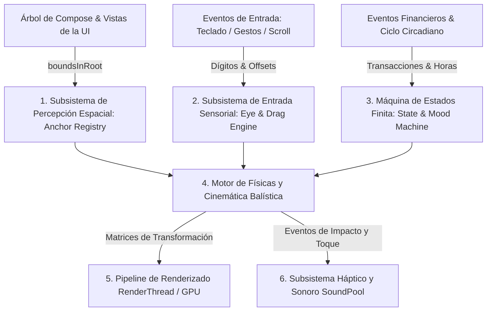

# 🐻 Arquitectura de Ingeniería del Motor Interactivo de Muggy

> **Especificación Formal de Sistemas, Cinemática, Físicas en RenderThread, Gestión de Coordenadas y Presupuestos de Rendimiento.**  
> Este documento define la ingeniería completa detrás de Muggy como subsistema interactivo de alto desempeño en Android nativo, garantizando 120 FPS estables, cero recomposiciones jank y adaptabilidad absoluta a cualquier resolución.

---

## 🏛️ 1. Visión General de la Arquitectura de Subsistemas

El motor de Muggy opera como un subsistema desacoplado dentro de la arquitectura de la aplicación, dividido en **6 capas de ingeniería independientes**:



---

## 🛰️ 2. Subsistema 1: Percepción Espacial y Mapeo de Coordenadas (`Scene Perception`)

### 2.1 El Problema del Mapeo Dinámico
En Android existen miles de factores de forma (pantallas de 5.5", plegables desplegados de 7.6", tablets de 11", esquinas redondeadas y punch-holes de cámara).  
**Principio de diseño:** Muggy jamás usa coordenadas absolutas en píxeles quemadas en código. Toda posición se deduce dinámicamente en tiempo de ejecución.

### 2.2 Arquitectura del `MuggyAnchorRegistry`
1. **Inspección de Coordenadas Raíz:**  
   Cada superficie interactiva (el borde del modal de registro, la barra de navegación, la tarjeta hero de balance o una meta de bolsillo) notifica su rectángulo delimitador en el espacio de coordenadas de la ventana (`boundsInRoot: Rect(left, top, right, bottom)`).
2. **Ciclo de Invalidación y Caché:**
   * La caché de coordenadas se actualiza durante la fase de *Layout* de Compose sin generar fases de recomposición adicionales.
   * **Resiliencia ante rotación o redimensionado (Foldables):** Ante cualquier evento `onSizeChanged` del contenedor raíz, el registro descarta la caché y recalcula los puntos de anclaje de inmediato.
3. **Puntos de Contacto Anatómicos de Muggy:**
   * **Punto de Apoyo (Paws Anchor):** Coordenada exacta en el borde superior de la tarjeta donde descansan las dos patitas (`Y = shelfTop + 4.dp`).
   * **Centro de Gravedad (Center of Mass):** Coordenada central de masa utilizada para calcular trayectorias balísticas parabólicas.

---

## 📐 3. Subsistema 2: Cinemática Balística y Simulación de Físicas

### 3.1 Trayectoria Parabólica mediante Curvas de Bézier Cuadráticas
Para garantizar un movimiento que transmita peso, inercia y gravedad real (y nunca una traslación lineal rígida), el salto entre un anclaje origen $P_0(x_0, y_0)$ y un anclaje destino $P_1(x_1, y_1)$ se rige por la ecuación cuadrática paramétrica:

$$P(t) = (1 - t)^2 P_0 + 2(1 - t)t P_{\text{apex}} + t^2 P_1 \quad \text{para } t \in [0, 1]$$

* **Cálculo del Ápice Dinámico ($P_{\text{apex}}$):**
  $$P_{\text{apex}}.x = \frac{P_0.x + P_1.x}{2}$$
  $$P_{\text{apex}}.y = \min(P_0.y, P_1.y) - h_{\text{arc}}$$
  * Donde $h_{\text{arc}}$ es la altura del arco balístico, proporcional a la distancia Euclidiana entre origen y destino ($h_{\text{arc}} = \max(60\text{dp}, d(P_0, P_1) \times 0.25)$).

### 3.2 Principios Clásicos de Animación: Deformación Elástica (*Squash & Stretch*)
Para simular un cuerpo orgánico con masa muscular y pelaje, las matrices de escala $(S_x, S_y)$ responden dinámicamente a las fases del salto:

| Fase del Salto | Rango $t$ | Deformación $(S_x, S_y)$ | Justificación Física |
|---|:---:|:---:|---|
| **Anticipación (Crouch)** | $0.00 \to 0.15$ | $(1.18, 0.82)$ | Flexión previa: compresión vertical y ensanchamiento horizontal para acumular impulso elástico. |
| **Vuelo Ascendente** | $0.15 \to 0.50$ | $(0.88, 1.18)$ | Elongación vertical alineada al vector de velocidad instantánea $\vec{v}(t)$. |
| **Ápice Parabólico** | $0.50 \to 0.70$ | $(1.00, 1.00)$ | Inercia cero momentánea en el punto más alto de la trayectoria. |
| **Aterrizaje (Impact Settle)** | $0.85 \to 1.00$ | $(1.08, 0.94) \to (1.0, 1.0)$ | Amortiguación con resorte elástico sub-amortiguado (`dampingRatio = MediumBouncy`). |

### 3.3 Mecánica de Caminata (*Walk Cycle*)
* **Oscilación de Cadera:** Función armónica periódica vertical $y(t) = \sin(2\pi f t) \times 3\text{dp}$.
* **Inversión de Espejo (Mirroring):** Cuando el desplazamiento es hacia la izquierda ($dx < 0$), se aplica una inversión geométrica en el eje X ($S_x = -1.0$) asegurando que Muggy siempre mire de frente hacia su dirección de avance.

---

## ⚡ 4. Subsistema 3: Pipeline de Renderizado RenderThread (Cero Jank / 120 FPS)

### 4.1 Eliminación Total de Recomposiciones en Fase de Animación
En el modelo de ejecución de Jetpack Compose, animar propiedades modificando estados de Compose normales (`mutableStateOf`) a 60–120 FPS causa miles de recomposiciones por segundo, saturando el Garbage Collector (GC) y causando tirones (*frame drops*).

**Estrategia de Renderizado en RenderThread:**
1. **Lectura Diferida (Deferred State Reads):** Toda propiedad animada (posición, escala, rotación, desplazamiento de pupilas) se consume exclusivamente dentro de la lambda del modificador `graphicsLayer { ... }`.
2. **Salto de Fases:** Compose salta las fases de **Composition** y **Layout**, actualizando únicamente los comandos de dibujo (*DisplayList*) directamente en el hilo gráfico nativo de Android (**RenderThread**).
3. **Aceleración por Hardware:** Las matrices afines de escala, traslación y rotación se ejecutan por hardware directamente en la GPU (vía Skia / Impeller).

---

## 👁️ 5. Subsistema 4: Entrada Sensorial y Expresiones Reactivas

### 5.1 Seguimiento Ocular en Tiempo Real (*Eye-Tracking Vectorial*)
* **Mapeo del Teclado Numérico:**  
  En el modal de registro rápido ([`Muggy en la app.jpg`](file:///c:/Users/AlekeyG11/Documents/VsCode/Andina/Muggy%20en%20la%20app.jpg)), el teclado numérico 3x4 está dispuesto asimétricamente a la izquierda.
* **Vector de Mirada de las Pupilas:**  
  Las capas vectoriales de las pupilas dentro de los anteojos se desplazan mediante un offset relativo $(dx, dy)$ acotado:
  * Teclas columna izquierda (`1`, `4`, `7`, `.`): Offset horizontal de $-3.5\text{dp}$.
  * Teclas columna central (`2`, `5`, `8`, `0`): Offset horizontal de $0\text{dp}$.
  * Teclas columna derecha (`3`, `6`, `9`, `⌫`): Offset horizontal de $+3.5\text{dp}$.
  * La transición entre dígitos utiliza un resorte con `dampingRatio = MediumBouncy` y `stiffness = Medium`, logrando un movimiento de mirada vivo y natural.

### 5.2 Tensión de Sujeción en Arrastre (*Drag Tension Physics*)
* Cuando el usuario arrastra el modal verticalmente hacia abajo para cerrarlo, la posición del BottomSheet genera un valor de desplazamiento continuo $\Delta Y$.
* **Mecánica de las patitas:** Las patitas delanteras de Muggy descansan en el borde con $Z\text{-Index} = 2$. Al detectar $\Delta Y > 0$, se aplica una tensión visual elástica (ligero estiramiento vertical de su silueta hacia arriba, simulando que Muggy se agarra con más fuerza del borde antes de desaparecer).

---

## 🧠 6. Subsistema 5: Máquina de Estados Determinista (`MuggyStateMachine`)

### 6.1 Matriz de Estados y Prioridades de Interrupción
Muggy no puede encontrarse en dos estados conflictivos simultáneamente. Su comportamiento se rige por una máquina de estados finita con prioridades estrictas:

```
Prioridad 1 (Crítica)    ──► Modo Privacidad (Tapándose los ojos)
Prioridad 2 (Transición) ──► Salto Parabólico / Caminata / Desplazamiento
Prioridad 3 (Contextual) ──► Asomado en Modal (PeekingTopSheet) / Celebración 100%
Prioridad 4 (Base)       ──► Reposo Circadiano (Despierto / Café mañana / Dormido noche)
```

### 6.2 Gestión Atómica de Coroutines
* Cada transición de locomoción corre en un `Job` hijo cancelable.
* **Política de Concurrencia:** Si el usuario ejecuta una acción rápida (ej. pulsar un botón mientras Muggy está a mitad de un salto), el motor aplica `conflate()` y cancela atómicamente la transición en curso (`job.cancel()`), ajustando la pose final al nuevo anclaje sin desfases ni fugas de coroutines en memoria.

---

## 🔊 7. Subsistema 6: Respuesta Sensorial Dual (Háptica + Audio de Baja Latencia)

### 7.1 Motor Háptico Táctil
* **Toque directo sobre Muggy:** Disparo de `HapticFeedbackType.LongPress` / micro-pulso seco en el motor lineal de vibración (ERM / LRA), proporcionando retroalimentación táctil de solidez física.
* **Cumplimiento de Meta (100%):** Patrón háptico festivo de doble pulso sincronizado con la lluvia de confeti orgánico.

### 7.2 Motor de Audio Nativo (`SoundPool`)
* Para evitar los retardos inaceptables de `MediaPlayer` (latencias de 100–300 ms), se utiliza **`SoundPool`** con canales precargados en memoria:
  * **`muggy_land_pop`:** Micro-sonido de impacto de madera cuando sus patitas tocan una repisa (latencia < 5 ms).
  * **`keypad_tap`:** Click táctil amortiguado en cada pulsación numérica.
  * **`goal_celebrate`:** Acorde pentatónico andino al completar una meta.
* **Gobernanza de Audio:** El subsistema consulta el `AudioManager` del sistema operativo: si el teléfono está en modo Silencio o No Molestar, o si el usuario desactivó el sonido en Ajustes, el motor silencia automáticamente los canales a nivel de hardware.

---

## 🍃 8. Subsistema de Ingeniería del Ecosistema Vivo: Fluidos, Flora y Partículas

Para que el entorno andino (frailejones, agua de páramo, rocío y viento) funcione a 120 FPS sin saturar la memoria RAM del dispositivo, se implementa un **motor ligero de partículas y simulación de fluidos en Canvas**:

### 8.1 Motor de Partículas Reutilizable con Cero Asignaciones (`ParamoParticlePool`)
* **El Reto Técnico:** Crear y destruir cientos de objetos `Particle` por segundo activaría el recolector de basura de Android (GC), provocando tirones gráficos (*jank*).
* **Solución de Ingeniería (Object Pooling):**
  * Se asigna un array fijo de tamaño acotado (`Array<LeafParticle>(30)` para hojas y `Array<PollenParticle>(25)` para polen).
  * Cuando una hoja termina su trayectoria, se recicla inmediatamente su índice sin pedir nueva memoria al sistema operativo.
* **Ecuación de Viento Andino:**
  * Cada partícula sigue una oscilación pendular combinada:
    $$x(t) = x_0 + v_x \cdot t + A \cdot \sin(\omega t + \phi)$$
    $$y(t) = y_0 + v_y \cdot t + \frac{1}{2} g_{\text{terminal}} \cdot t^2$$
  * Simula la resistencia del aire y el vuelo flotante de las hojas secas de frailejón.

### 8.2 Dinámica de Fluidos: Ondas de Agua Cristalina (*Water Ripple Engine*)
* **Mecánica del Ingreso (+):**  
  Al registrar una entrada de dinero en una billetera, se dispara un efecto de ondas concéntricas en un único `Canvas` superpuesto:
  * Radio dinámico: $R(t) = R_{\max} \cdot (1 - e^{-\lambda t})$.
  * Opacidad: $\alpha(t) = \alpha_0 \cdot e^{-\gamma t}$.
  * Renderizado mediante `drawCircle(style = Stroke(width = 2.dp))` con gradiente translúcido en color `AndeanMoss` (`#435C3C`).

### 8.3 Cinemática de la Gota de Rocío en Pull-to-Refresh
* La gota de agua no es una imagen fija; es un trazado vectorial paramétrico (*Bézier Spline*) que se deforma elásticamente según la distancia de arrastre del usuario $\Delta Y$:
  * A medida que el usuario tira hacia abajo, el cuello de la gota se adelgaza proporcionalmente a $\frac{1}{\Delta Y}$.
  * Al superar el umbral de disparo (`80.dp`), la tensión superficial se rompe, la gota se desprende con aceleración de gravedad y un resorte sub-amortiguado refresca la lista.

---

## 📊 9. Presupuesto de Rendimiento y Criterios de Aceptación (SLAs)

Para garantizar que el subsistema nunca degrade la experiencia de la app financiera, el motor debe cumplir estrictamente con los siguientes límites métricos:

| Métrica de Rendimiento | Límite Máximo Permitido | Mecanismo de Garantía |
|---|:---:|---|
| **Tasa de Refresco Gráfica** | **60 a 120 FPS constantes** | Renderizado exclusivo en GPU vía lambdas de `graphicsLayer`. |
| **Presupuesto de Cuadro (Frame Budget)** | **≤ 8.33 ms** (en paneles 120 Hz) | Cero invocaciones al recolector de basura (GC) durante animaciones. |
| **Consumo de Memoria RAM** | **< 6 MB adicionales** | Assets vectoriales puros y reciclaje de pools de audio. |
| **Uso de CPU en Reposo** | **< 0.5%** | Animaciones sinusoidales suspendidas cuando la pantalla está estática o en segundo plano. |
| **Comportamiento en Scroll Rápido** | **0 FPS en Muggy** | Suspensión instantánea de locomoción al detectar `isScrollInProgress == true`. |
| **Accesibilidad (Motion Reduced)** | **Transición a 0 ms** | Si el OS tiene desactivadas las animaciones, el salto se convierte en posicionamiento instantáneo. |
